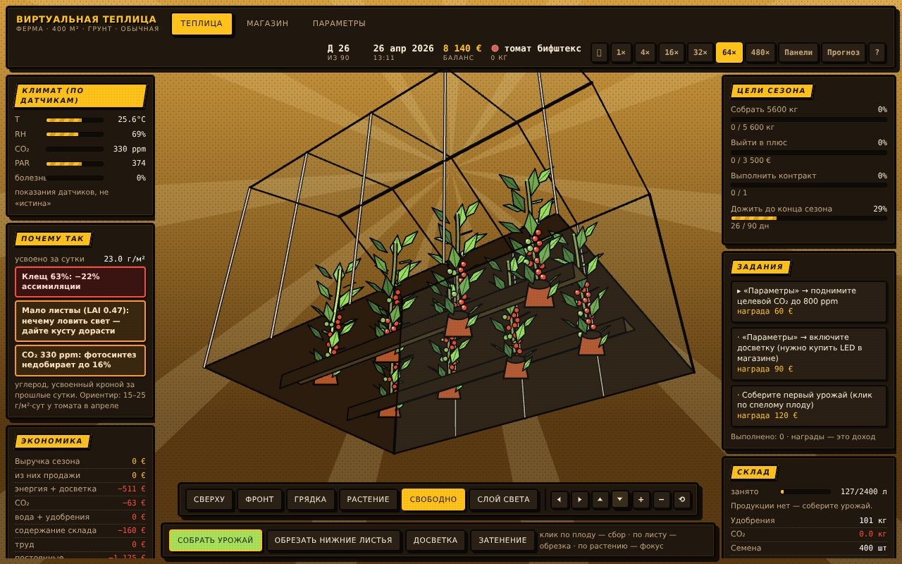
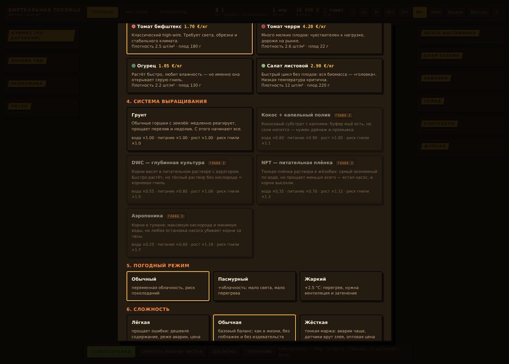
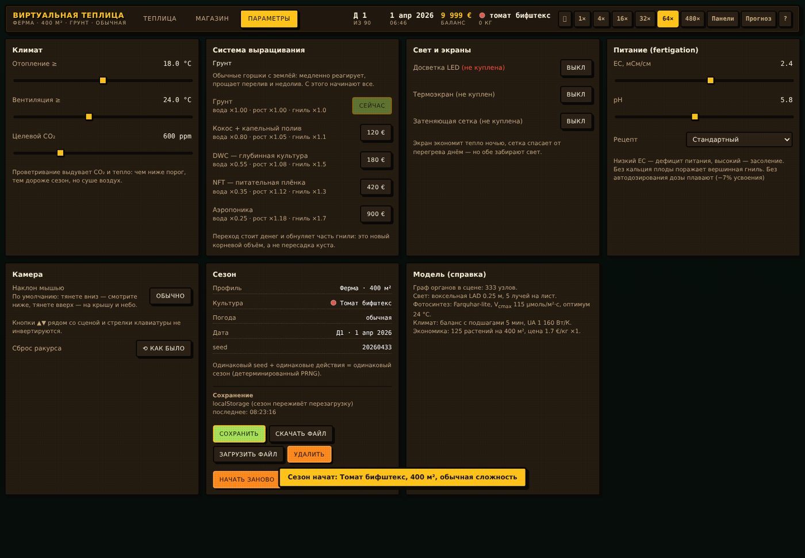
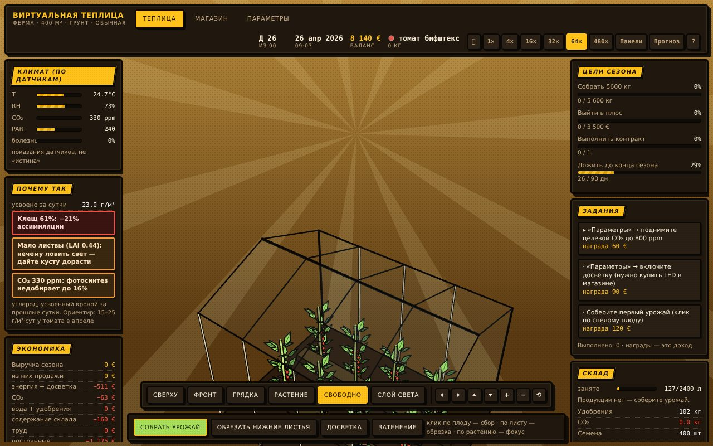

# Виртуальная теплица

Симулятор теплицы в комиксовой эстетике Borderlands: свет, фотосинтез, климат, склад с лёжкостью,
рынок с сезонными ценами, контракты и кампания от балкона до сети теплиц. Всё — в одном
HTML-файле, без сборщиков, зависимостей и бэкенда.

**Играть онлайн:** https://GITHUB_USER.github.io/GITHUB_REPO/

[](https://GITHUB_USER.github.io/GITHUB_REPO/)

| Старт: выбор системы выращивания | Параметры: камера | Взгляд вверх на крышу |
|---|---|---|
|  |  |  |

## Что это

* 3D-сцена теплицы на canvas: граф органов растения, воксельный свет (LAD 0,25 м), расчёт
  фотосинтеза по Farquhar-lite. Улучшения сцены дают пользу: слой света красит листья по
  поглощённой радиации и показывает, какие листья голодают.
* Климат с подшагами 5 минут: отопление, вентиляция, CO₂, влажность, термоэкран, сетка.
* Экономика: реальные цены, склад с лёжкостью и расширением, рынок с недельными колебаниями,
  контракты. Пауза — реальное время с догоном.
* Кампания со 100 € и балкона: главы, письма, постепенное введение оборудования, цель — сеть филиалов.
* Пять систем выращивания: грунт, кокос + капли, DWC, NFT, аэропоника. Разная вода, удобрения,
  урожайность и риск корневой гнили.
* Скорость: 1× = 1 игровой час за реальную минуту, до 480× (сутки за 3 секунды), плюс пауза 1:1.

## Как запустить у себя

```bash
git clone https://github.com/GITHUB_USER/GITHUB_REPO.git
cd GITHUB_REPO
./serve.sh          # http://localhost:8080
```

Или просто откройте `index.html` в браузере — он самодостаточный (всё внутри, ни одного
внешнего файла). Для сохранения прогресса нужен `http://` или `file://` — `localStorage`.

## Как это устроено

`index.html` собирается из четырёх частей, правится только они:

```bash
./build.sh          # parts/head.html + parts/core.js + parts/render.js + parts/ui.js -> index.html
node test3_dom.js   # интерфейс в jsdom-заглушке
node test2_core.js  # модель: свет, климат, рост, экономика
node test4_lamp.js  # досветка: ручное включение, будильник-напоминание, миграция сохранений
node test5_co2.js   # клапан CO₂: покупной, без него домашний воздух 600–800 ppm
node test6_economy.js # экономика: цены и крафт, продажи, склад, займ, контракты, бухгалтерия, прибыль
node test7_story.js   # сюжет: главы, письма, замки магазина, кампания целиком, сохранение, сеть
node tools/check_cam4.js   # камера: наклон вверх/вниз, инверсия, кнопки
```

Зависимостей у игры нет. Тесты используют `playwright-core` + `@sparticuz/chromium`
(нужны только для разработки).

* `parts/core.js` — модель: свет, климат, рост, склад, рынок, кампания, PRNG.
* `parts/render.js` — сцена: камеры и проекции, отрисовка, hit-test.
* `parts/ui.js` — интерфейс: страницы, панели, ввод, сохранения, темп времени.
* `handoff.md` — технические решения, что уже ломалось и почему; `GDD.md` — дизайн-документ.

---

# Виртуальная теплица — браузерный симулятор растения и хозяйства

Одностраничная игра: вы управляете теплицей 90 дней, а растение внутри — не картинка,
а **функционально-структурная модель** (FSPM) в духе VirtualPlantLab:
граф органов → turtle-геометрия → свет по листьям → фотосинтез → прирост биомассы → урожай.

Открыть: `index.html` (всё в одном файле, зависимостей нет — нужен только браузер).
Локальный сервер для превью: `./serve.sh` → <http://localhost:8080/>.

## Что происходит на экране

Три страницы, переключаются вкладками сверху.

**Теплица** — только дашборд и 3D-сцена:
* слева — датчики (T, RH, CO₂, PAR, болезнь) и экономика сезона;
* центр — сцена с пятью камерами: `1` сверху (план), `2` фронт (разрез), `3` фокус на грядке,
  `4` фокус на растении, `5` свободное вращение (зажать и вести мышью; колесо — зум; из любого
  фиксированного вида перетаскивание автоматически включает свободный);
* справа — задания, склад, контракты, журнал;
* снизу — быстрые действия: «Собрать урожай», «Обрезать нижние листья», «Досветка», «Затенение»;
* клик по сцене: плод — собрать, лист — обрезать, растение — выбрать фокус.
* сверху — день и дата (`Д 12 · 22 апр 2026`), часы, баланс, скорости `1× / 4× / 16× / 64×`,
  пауза, кнопка «Прогноз».

**Магазин** — траты, пять групп:
* **Бюджетный старт (реальные цены)** — контрольный термометр-гигрометр 28 €, клейкие ловушки 45 €,
  бочка дождевой воды 90 €, обдув кроны 120 €, ручной EC/pH-метр 160 €, LED-лента 220 €,
  увлажнитель 260 €, ИБП для котла 380 €, плёнка-экран 520 €, климат-контроллер 690 €.
  Цены фиксированные (не зависят от площади профиля) — это первые траты в сезоне;
* **Оборудование (профессиональное)** — LED-досветка, форсирование, термоэкран, затеняющая сетка,
  автодозирование, второй комплект датчиков, работник, плановый сервис;
* **Расходники** — удобрения, CO₂, вода, семена, автозакупка;
* **Сервис и защита** — ремонт, калибровка, сервисный контракт, страховка, биозащита, метеосервис;
* **Защита растений** — обработки от клеща и серой гнили. Плюс предложения контрактов.

**Параметры** — уставки: отопление, вентиляция, CO₂, EC/pH, рецепт питания,
переключатели досветки / экрана / сетки, будильник досветки (напоминает включить и выключить
свет по времени), справка о модели, seed и «Начать заново».

## Игровой цикл

1. **Старт**: профиль капитала (1 000 / 10 000 / 100 000 €), культура (томат, черри, огурец, салат),
   погодный режим и **сложность** — «Лёгкая» / «Обычная» / «Жёсткая» (множители постоянных расходов,
   частоты аварий, дрейфа датчиков и цены реализации; от капитала не зависит).
   Старт сезона — 1 апреля, 90 дней. Первые действия подсказывает обучение из 5 шагов.
2. **Наблюдайте** датчики, а не «истину»: они дрейфуют, и об этом надо догадаться
   (признак — расхождение, если куплен второй комплект; иначе — «давно не калибровались»).
3. **Тратьте**: свет, CO₂, питание, вентиляция. Каждое решение — деньги против урожая.
4. **Собирайте** урожай (или купите работника) и закрывайте контракты.
5. **Риски**: отказы оборудования, отключения питания, инциденты (ливень, град, жара),
   вредители, серая гниль. Страховка и сервис их смягчают.
6. **Прогноз**: панель считает 7 / 14 / 30 дней на клоне мира с независимой погодной ветвью:
   урожай, прибыль, предупреждения. Это оценка, а не гарантия — погода в клоне своя.

Деньги: выручка = урожай × цена культуры × коэффициент профиля ± контракты.
Расходы: энергия (отопление + досветка), CO₂, вода, удобрения, труд, постоянные, штрафы, сервис.

## Склад и продажа урожая

Собранный урожай **не превращается в деньги сам**: он ложится на склад, а деньги приносит продажа.

* **«Продать всё»** в панели «Склад» — по **цене дня**. Цена ходит каждый день (видно в магазине:
  «цена дня: 1,60 €/кг ▲ растёт»), так что можно придержать партию и продать дороже.
* **Лёжкость** у культур разная: салат 4 дня, огурец 7, черри 9, томат 12. Каждый день партия
  теряет часть веса, а качество (и цена) падает — на складе видно «ещё 4 дн · 100%».
  Испорченное считается в «испорчено за сезон».
* **Контракты** забирают продукцию со склада: кнопка «Поставить со склада» платит по цене дня
  с наценкой ×1,25–1,6 и добавляет бонус при выполнении.
* **Склад не резиновый**: он измеряется в литрах (одна секция — 600 л), у каждой покупки есть объём.
  Если места нет — покупка не пройдёт, а лишний урожай останется на грядке.
* **Расширение стоит денег дважды**: секция покупается (+секция, 180–900 € в зависимости от профиля)
  и потом тянет содержание — в «Экономике» отдельная строка «содержание склада».
  Считать просто: больше склада — больше постоянных расходов, но меньше потерь от порчи.

## Пауза, время и оффлайн

* **Пауза больше не останавливает время.** На ней одна реальная секунда равна одной игровой:
  сутки идут 24 часа, микроклимат продолжает жить, датчики плывут. Кнопка в шапке так и подписана — «1:1».
* Ускорения 1×…64× остались; «Прогноз» считает вперёд, не трогая текущий мир.
* **Закрыли вкладку — сезон продолжился.** При возврате игра догоняет пропущенное по реальным часам
  (не больше трёх суток за раз) и пишет в журнал: «Пока вас не было (2.0 ч): собрано 12 кг · баланс +34 €».

## Кампания «со 100 €»

Отдельный режим на стартовом экране. Четыре главы, капитал фиксирован — сто евро и балкон:

| Глава | Площадь | Цель (продажи за главу) | Цена переезда |
|---|---|---|---|
| Балкон | 4 м² | 350 € | — |
| Комната | 20 м² | 1 500 € | 380 € |
| Теплица | 400 м² | 3 000 € | 1 000 € |
| Сеть | филиалы по 400 м² | 12 000 € + три филиала | письмо наставника |

* Считаются **продажи**, а не баланс: взятый кредит — не заработок.
* Между главами приходит **письмо от тёти Розы** с выбором: переехать, переехать с кредитом
  или остаться и подкопить. Выбор меняет стартовые условия: долг, запас расходников, оборудование.
* Сезон кампании — 210 дней. На балконе ценят прямое качество (цена выше оптовой), поэтому
  маленький объём всё равно окупается — но потолок близко, и на теплицу нужен запас на топливо.
* Балкон и комната выглядят иначе: стена с окном, горшки на полу, перила вместо стеклянного каркаса.

### Обучение покупкам

Кампания — обучающий режим, поэтому магазин в ней работает как расписание, а не как каталог:

* вещи **открываются по главам**. Балкон: термометр-гигрометр, клейкие ловушки, LED-лента, вода,
  удобрения, секция склада, калибровка, обработки. Комната: обдув кроны, ручной EC/pH-метр, плёнка-экран,
  второй комплект датчиков, затеняющая сетка, биозащита, метеосервис, бочка, мешок удобрений, CO₂ 50 кг,
  семена, ремонт. Теплица: климат-контроллер, ИБП, досветка и форсирование, термоэкран, автодозирование,
  работник, сервис и страховка, CO₂ 200 кг, автозакупка;
* у каждой карточки есть строка **«Зачем»** — какую проблему она решает, человеческим языком;
* закрытые карточки видны, но не покупаются: понятно, что будет дальше и почему этого пока нет;
* наставник присылает письма «что купить на первые деньги» после переезда в комнату и в теплицу.

В свободном сезоне ограничений нет — все вещи доступны сразу, подписи «зачем» остаются.

### Сеть теплиц (финал)

После 3 000 € продаж в теплице тётя Роза предлагает строить сеть. Филиал — 400 м² под наёмным
агрономом: 3 500 €, каждый следующий дороже на 25 %, содержание 48 €/сут на филиал, оптовая цена
×0.85 от рыночной. Выходит около 50–65 € чистыми в день с филиала. Филиал считается **укрупнённо**
(кг с м² в сутки по культуре), а не покамерно — см. «Что модель не умеет». Цель главы: три филиала
и 12 000 € продаж; после неё приходит финальное письмо.

## Сохранение

Сезон можно закрыть и вернуться в него:

* автосохранение — на каждой смене игрового дня и раз в 30 секунд, плюс при уходе со страницы;
* вручную — кнопка с дискетой в верхней панели, `Ctrl+S` или «Сохранить» в «Параметрах»;
* при следующем открытии в окне «Новый сезон» появляется баннер **«Продолжить сезон»**
  (день, культура, собранный урожай, баланс, время сохранения) с кнопками «Продолжить» и «Удалить»;
* в «Параметрах» есть **скачивание и загрузка файла** `.json` — переносит сезон между браузерами
  и работает даже там, где браузер блокирует хранилище (например, в песочнице предпросмотра).

Хранилище выбирается автоматически: `localStorage` → `sessionStorage` → память вкладки.
В «Параметрах» написано, какой уровень доступен. Сохраняются мир целиком (растения, климат,
деньги, события, PRNG) и положение камеры; незавершённый прогноз не сохраняется.

## Скорости и время

Скорость задаётся в **игровых часах за реальную минуту**, от реального времени:

| Кнопка | Игровое время | Сутки за |
|---|---|---|
| 1× | 1 час за минуту | 24 мин |
| 4× | 4 часа за минуту | 6 мин |
| 16× | 16 часов за минуту | 90 с |
| 32× | 32 часа за минуту | 45 с |
| 64× | 64 часа за минуту | 22 с |
| 480× | 480 часов за минуту | 3 с |
| 1:1 (пауза) | секунда за секунду | 24 ч |

Шаг симуляции ≤ 0.5 ч, внутри климата — подшаги до 5 минут (иначе регуляторы «звенят»).
Порог шага подстраивается под скорость (`thr = min(1/12, rateH*0.25)`), поэтому на 1× мир
идёт мелкими шагами и не «дёргается» раз в пять секунд.

Часы и баланс в верхней панели идут на любой вкладке — можно уйти в магазин и вернуться,
сезон не останавливается.

## Система выращивания

На старте (и в «Параметрах») выбирается, в чём растёт корень:

| Система | Вода | Питание | Рост | Риск гнили | Открывается |
|---|---|---|---|---|---|
| Грунт | ×1.00 | ×1.00 | ×1.00 | ×1.0 | сразу |
| Кокос + капли | ×0.80 | ×0.90 | ×1.05 | ×1.1 | глава 2 |
| DWC (глубинная культура) | ×0.55 | ×0.80 | ×1.08 | ×1.5 | глава 2 |
| NFT (питательная плёнка) | ×0.35 | ×0.70 | ×1.12 | ×1.3 | глава 3 |
| Аэропоника | ×0.25 | ×0.60 | ×1.18 | ×1.7 | глава 3 |

* Гидропоника даёт прибавку к сухому веществу, но **чувствительнее к EC/pH** (множитель `ecSens`),
  охотнее гниёт и требует электричества: без питания насоса прибавка снимается, а риск корневой гнили растёт.
* На сцене ёмкость под растением рисуется по системе: терракотовый горшок с землёй, белый бак
  с голубым раствором и пузырьками (DWC/NFT), плита кокоса с капельницей, белая корзина с туманом.
* Смена системы в «Параметрах» стоит денег и снимает часть гнили — это новый корневой объём.
* Замер на 60 днях (комната, томат): грунт 162 кг, кокос 161, DWC 171, NFT 174, аэропоника 190 кг;
  средняя гниль за период 0 / 0.1 / 0.6 / 0.1 / 11.4 %.

## Камера, планшет, телефон

* Перспективные виды («грядка», «растение», «свободно») используют одно состояние камеры:
  точка взгляда, наклон, дистанция, зум. Кнопки вида лишь переводят камеру в нужное положение —
  плавно, поэтому при перетаскивании из «грядки» ничего не прыгает.
* Мышь и палец обрабатываются одинаково (Pointer Events): тянуть — поворот, колесо или щипок —
  зум, правая кнопка или Shift — сдвиг точки взгляда, двойной щелчок — исходный ракурс.
  После отпускания есть короткая инерция.
* Наклон работает в обе стороны одинаково далеко: вниз — сверху на грядку, вверх — на крышу
  и небо (сцена «запрокидывает голову», камера остаётся у пола, а не уходит под него).
  Если удобнее обратное направление мыши, в «Параметрах» есть карточка «Камера» с переключателем
  «Наклон мышью: обычно / инверсия» — он запоминается в браузере и не сбрасывается вместе с сезоном.
* Для тех случаев, когда перетаскивание неудобно (тачпад, стилус, удалённый рабочий стол),
  в панели видов есть кнопки `◀ ▶ ▲ ▼ + − ⟲` и клавиши: стрелки — поворот, `+`/`−` — зум, `R` — сброс.
  Кнопки и клавиши инверсией не затрагиваются: `▲` — всегда «смотреть выше».
* Верхняя панель переносит кнопки на вторую строку, если места мало, а её реальная высота
  передаётся в раскладку — поэтому «Пауза» и скорости не уезжают за край и не перекрываются подсказками.
* Широкий экран — три колонки. Планшет (≤1180 px) — показания слева, остальное в шторке справа.
  Телефон (≤720 px) — только сцена, сверху компактная строка (день, дата, баланс, скорости),
  снизу док: «Климат», «Почему», «Деньги», «Дела», «Склад», «Почта». Шторка закрывается
  повторным нажатием, кнопки дока без видимых панелей не показываются.

## Модель (коротко и честно)

* **Растение = граф органов**: узел `root` → фитомеры → (`internode`, `leaf`, `truss` → `fruit`).
  Филлотаксис 137.5°, угол листа 50°, филлохрон в °C·сут (база 8 °C). Появление нового
  фитомера — правило на тепловом времени, листья стареют, отмирают в тени, плоды наливаются.
* **Свет**: воксельная сетка LAD 0.25 м внутри кроны, 5 лучей на лист, перекрытие соседями —
  суррогат трассировки Монте-Карло из PlantRayTracer (полный рейтрейсинг здесь не нужен
  интерактивно, но именно он — эталон калибровки, см. `handoff.md`).
* **Фотосинтез**: Farquhar-lite (V<sub>cmax</sub>, J<sub>max</sub>, θ, Γ*), поправки на возраст листа,
  температуру, стресс, питание, болезнь; дыхание и отток в плоды/листья/стебель.
* **Климат**: энергобаланс с релаксацией к равновесию, UA конструкции + вентиляция,
  транспирация и скрытое тепло, CO₂-баланс (инжекция против фотосинтеза и проветривания),
  влажность, досветка, экран, затеняющая сетка.
* **Экономика**: калибрована под реальные порядки — 15–19 кг/м² за 90 дней по томату/огурцу,
  8–11 кг/м² по салату, энергия 25–35 €/сут на 400 м².
* **Детерминизм**: PRNG — часть состояния мира, `seed` + одинаковые действия дают одинаковый сезон.
  Сохранение/воспроизведение = seed + журнал решений (в браузере пока не сделано, см. roadmap).

## Что модель не умеет (и не притворяется, что умеет)

Это важно понимать до того, как верить цифрам:

* **Нет валидации по реальному хозяйству.** Все коэффициенты подобраны так, чтобы урожайность
  и себестоимость попадали в литературные диапазоны (15–19 кг/м² за 90 дней у томата и огурца),
  а не по замерам конкретной теплицы. Считать это «моделью вашей теплицы» нельзя.
* **Свет — суррогат.** Вместо фотонного Монте-Карло рейтрейсинга (PlantRayTracer.jl) —
  воксельная сетка LAD 0.25 м и 5 лучей на лист. Перехват света внутри кроны приближённый,
  отражения и многократное рассеяние не считаются.
* **Лист — одна пластина.** Нет анатомии, толщины, устьичной динамики; транспирация — эмпирическая
  функция VPD и света, а не энергобаланс листа (PlantBiophysics.jl).
* **Нет гидравлики и транспорта ассимилятов.** Углерод распределяется пропорциями, а не по потокам
  во флоэме; водный стресс — множитель, а не давление в ксилеме.
* **Болезнь и вредитель — вероятностные модели.** Серая гниль и клещ растут как «уровень риска»
  от влажности/температуры, это не эпидемиология с инокулюмом и споруляцией.
* **Климат — одна зона.** Один объём воздуха, без стратификации по высоте и градиентов у стен.
* **Нет MTG-совместимости и многолетних циклов.** Граф органов живёт один сезон, обрезка/подвязка
  упрощены, корневая система не моделируется.
* **Экономика — игровая.** Цены, тарифы и стоимость оборудования взяты реалистичными по порядку,
  но не являются котировками; рынок не двигается (пока).
* **Склад — один общий объём.** Нет отдельных полок, холодильника и разной температуры хранения:
  лёжкость — это срок культуры, а не режим склада. Холодильная секция (продлить срок за энергию)
  пока не сделана.
* **Кампания проходима неровно.** На теплице уверенно выходят томат и огурец; салат и черри
  на 400 м² у автоигрока уходят в минус — им нужен либо свет, либо более короткий сезон.
* **Филиал сети — агрегат, а не вторая теплица.** У него нет своих органов, света и климата:
  только кг с м² в сутки, оптовая цена и содержание. Иначе пришлось бы моделировать шесть
  теплиц одновременно, а интерфейс из симулятора растения превратился бы в менеджер.
* **Сохранение — это снимок мира, а не «облако».** Файл `.json` живёт у вас; синхронизации между
  устройствами нет, история решений не пишется (только состояние + PRNG).

Что считать проверенным: баланс 12 комбинаций «профиль × культура» за 90 дней (все в плюсе,
урожайность в реальном диапазоне), устойчивость климата (T 15–27 °C без автоколебаний),
отсутствие NaN и утечек состояния в прогнозе. Что не проверено: соответствие реальным данным.

## Файлы

| файл | что это |
|---|---|
| `index.html` | собранная игра (единственный нужный файл) |
| `parts/head.html` | CSS + разметка (панели, вкладки, модалки) |
| `parts/core.js` | ядро без DOM: культуры, климат, свет, фотосинтез, экономика, риски, прогноз |
| `parts/render.js` | сцена: камеры, проекции, отрисовка, hit-test |
| `parts/ui.js` | вкладки, дашборд, магазин, параметры, главный цикл |
| `build.sh` | пересобрать `index.html` из частей + проверить синтаксис |
| `test2_core.js` | матрица 3 профиля × 4 культуры × 90 дней (баланс) |
| `test3_dom.js` | дымовой тест интерфейса на заглушках DOM |
| `diag4.js` | быстрая диагностика климата/роста (40 дней) |
| `GDD.md` | дизайн-документ (зафиксированная концепция) |
| `handoff.md` | инженерное состояние: что сделано, что нет, как продолжать |
| `v1_prototype.html` | предыдущая версия, для сравнения |
| `tools/shot.js`, `tools/shot2.js` | снимки сцены через Playwright (нужен chromium) |

## Проверки

```bash
./build.sh                # сборка + синтаксис
node test3_dom.js         # интерфейс: старт, кадры, страницы, камеры, прогноз, сезон
node test2_core.js        # баланс: 12 комбинаций по 90 дней (~50 с)
node test4_lamp.js        # досветка: ручное включение, будильник, миграция сохранений
node diag4.js             # климат и рост, 40 дней (~2 с)
```

Отладочный API в консоли браузера: `VG.world`, `VG.start({profile:'farm',crop:'tomato'})`,
`VG.sim(24)`, `VG.harvest()`, `VG.buy('led')`, `VG.predict(7)`, `VG.cam('top')`, `VG.set('co2Set', 900)`.
